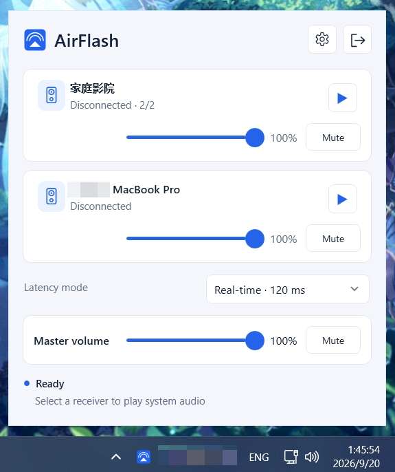

#  AirFlash

<p align="center">
  <a href="README.md">English</a> ·
  <a href="docs/README.zh-CN.md">简体中文</a>
</p>

<p align="center">
  
</p>

AirFlash supports existing two-device stereo pairs and low-latency playback from Windows.
Stream Windows desktop audio to HomePod through a native AirPlay 2 sender,
with support for HomePod OS 27.

AirFlash is an AirPlay 2 alternative to TuneBlade (AirPlay 1), designed to bring
Windows audio streaming to HomePods running newer versions of HomePod software.

## Installation

Download the latest release from [GitHub Releases](https://github.com/Ding-Kyoma/AirFlash/releases/latest), run
`AirFlash-X.Y.Z.msi`, and launch AirFlash from the installed shortcut. Apps and Features provides repair and uninstall.

The minimum target is **Windows x64, Windows 10 1809 / build 17763** (LTSC 2019),
including LTSC 2021, 22H2 and Windows 11. Windows 10 qualification is pending
affected-user testing. See [Windows compatibility and startup diagnostics](docs/WINDOWS-COMPATIBILITY.md)
for the candidate status and the PowerShell 5.1 diagnostic collector.

AirFlash is distributed as a Windows x64 executable and standalone MSI. Windows may show
a SmartScreen warning because release binaries are not code-signed. Use
**More info** and **Run anyway** only when the downloaded files are from a
source you trust.

For audio capture, we recommend **Settings > Audio capture > Specific audio endpoint**.
If you do not have an unused audio endpoint available, install a virtual endpoint
with [Virtual Audio Cable (VAC Lite)](https://software.muzychenko.net/freeware/vac471lite.zip)
or a similar tool, and route the audio you want to stream to that endpoint.

## Key features

- Streams Windows system audio to HomePod over AirPlay 2.
- Supports synchronized playback on existing two-device HomePod stereo pairs.
- Offers automatic device discovery, PIN pairing, and manual device setup.
- Lets you filter device discovery by selecting a network adapter in Settings.
- Includes selectable latency modes, tray operation, mute restoration,
  automatic reconnection, and connection diagnostics.
- Provides a ten-band equalizer with presets and live preview in Settings.
- Captures playback or recording endpoints, including virtual audio devices.
- Available as a portable Windows x64 app with English, Simplified Chinese, and Traditional Chinese UI.

## Feature plan

- [ ] Select an application as the audio source ([#18](https://github.com/Ding-Kyoma/AirFlash/issues/18)).
- [ ] Dolby Atmos support.

## Usage

1. Connect the PC and both HomePods to the same reachable local network.
2. Start AirFlash and wait for the receiver list to populate.
3. Select the complete `HomePod stereo · 2/2` entry and press play.
4. Complete PIN pairing in **Settings > Receivers** if the receiver requests it.
5. Choose the capture endpoint and latency profile in Settings when the defaults
   are not suitable.

In **Settings > Audio capture**, **Specific audio endpoint** lists active playback
and recording devices with their type. For Voicemeeter, select the recording
endpoint corresponding to its B1/B2/B3 bus (for example, Voicemeeter Output)
and enable that bus for the desired audio in Voicemeeter. Playback devices use
loopback; recording devices capture their input directly. Automatic local mute
applies only to playback devices and never mutes a recording input.

Receiver discovery runs while the control panel or **Settings > Receivers** is
visible, and pauses when both are hidden. Previous results remain available;
pausing discovery does not interrupt playback. If automatic connection is enabled
globally or for a receiver, AirFlash also discovers devices for ten seconds at
startup. Open a receiver list to resume discovery afterwards.

AirFlash intentionally uses fresh application storage under `%APPDATA%/AirFlash`
and `%LOCALAPPDATA%/AirFlash`. It does not read configuration, credentials, or
engine caches created by the previous product name; users must configure and pair
again after installing AirFlash.

Use **Settings > About > Check for updates** to check for a stable release and open its download page. Checks run only when requested.

The real-time profile targets 120 ms; target and local transport timings are not measurements of end-to-end acoustic latency.

See [Release workflow](docs/RELEASING.md) for version reservation and publishing.

See [Icon maintenance](docs/ICONS.md) for the vector source, generated resources, and high-DPI verification.

## Stack

- **C# / .NET 10 / WPF** for the Windows UI, tray integration, settings, and discovery
- **Rust** for WASAPI capture, AirPlay 2 sessions, HAP, PTP, RTP, and audio transport
- **Windows DNS-SD** for receiver discovery
- **WASAPI loopback** for system audio capture
- **PCM and ALAC** with encrypted RTP for HomePod playback
- **uv, pytest, and Ruff** for the finite validation tools and Python checks

The published application is self-contained and statically links the native MSVC runtime. It does not require Python, a separately installed .NET runtime, or a separately installed VC++ Redistributable.

## Development and build

Development requires Windows 10/11 x64, the .NET 10 SDK, the Rust MSVC toolchain,
and Visual Studio C++/Windows SDK components. Python 3.12+ and `uv` are used for
validation scripts only.

```powershell
uv sync --locked
pwsh scripts/build-native.ps1 -Check
pwsh scripts/dotnet.ps1 restore AirFlash.sln --locked-mode
pwsh scripts/dotnet.ps1 run --project AirFlash.App/AirFlash.App.csproj
pwsh scripts/build.ps1
```

The build produces:

- `dist/AirFlash.exe`
- `dist/AirFlash-X.Y.Z.msi`

Run `AirFlash-X.Y.Z.msi` directly. It installs the self-contained executable and provides optional desktop and Start menu shortcuts.
AirFlash uses the Windows DNS-SD API and does not require Bonjour or install a background service.
The Rust engine is embedded in the WPF executable and extracted to a content-addressed cache under `%LOCALAPPDATA%/AirFlash/engine/<hash>` at runtime.

## Tests

```powershell
pwsh scripts/dotnet.ps1 test AirFlash.sln
uv run pytest
uv run ruff check .
pwsh scripts/build-native.ps1 -Check
```

The ignored Rust soak test uses localhost UDP receivers only. Real HomePod tests
are intentionally limited to the repository's low-volume, five-second procedure.

See [Discovery stability](docs/DISCOVERY-STABILITY.md) for the isolated playback
retention regression check and repair validation notes.

## Contributing

Keep protocol behavior, pairing boundaries, and measurement limits explicit in
changes. Pull requests are welcome!

## License

[GPLv3+](LICENSE-GPLv3) or [Commercial License](LICENSE-COMMERCIAL.md).
