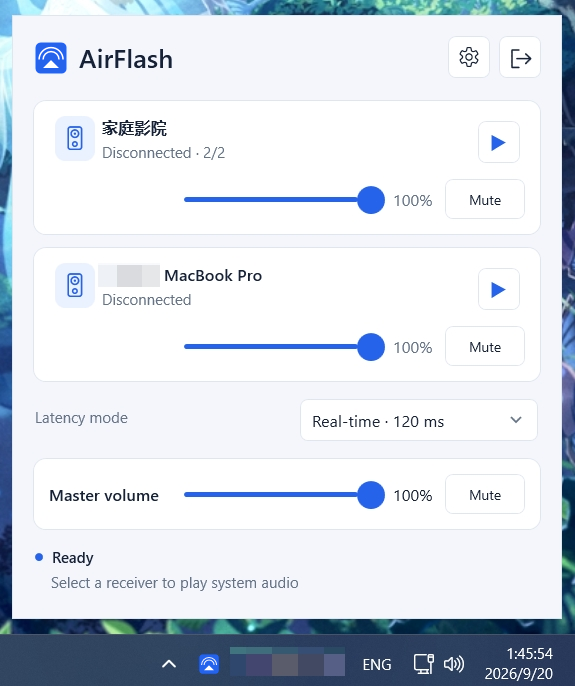

#  AirFlash

<p align="center">
  <a href="../README.md">English</a> ·
  <a href="README.zh-CN.md">简体中文</a> ·
  <a href="README.es.md">Español</a>
</p>

<p align="center">
  
</p>

AirFlash admite pares estéreo existentes de dos dispositivos y reproducción de baja latencia desde Windows.
Transmite el audio del escritorio de Windows al HomePod a través de un emisor nativo de AirPlay 2,
con soporte para HomePod OS 27.

AirFlash es una alternativa con AirPlay 2 a TuneBlade (AirPlay 1), diseñada para llevar
la transmisión de audio desde Windows a los HomePods que ejecutan versiones más recientes del software de HomePod.

## Instalación

Descarga la última versión desde [GitHub Releases](https://github.com/Ding-Kyoma/AirFlash/releases/latest), ejecuta
`AirFlash-X.Y.Z.msi` e inicia AirFlash desde el acceso directo instalado. Aplicaciones y características permite reparar y desinstalar.

El objetivo mínimo es **Windows x64, Windows 10 1809 / compilación 17763** (LTSC 2019),
incluidos LTSC 2021, 22H2 y Windows 11. La certificación en Windows 10 está pendiente
de pruebas de usuarios afectados. Consulta [Compatibilidad con Windows y diagnósticos de inicio](WINDOWS-COMPATIBILITY.md)
para conocer el estado de la versión candidata y el recolector de diagnósticos para PowerShell 5.1.

AirFlash se distribuye como un ejecutable x64 para Windows y un MSI independiente. Windows puede mostrar
una advertencia de SmartScreen debido a que los binarios publicados no están firmados con código. Utiliza
**Más información** y **Ejecutar de todas formas** solo si los archivos descargados provienen de una
fuente de confianza.

Para la captura de audio, recomendamos **Configuración > Captura de audio > Dispositivo de audio específico**.
Si no tienes disponible un dispositivo de audio sin usar, instala uno virtual
con [Virtual Audio Cable (VAC Lite)](https://software.muzychenko.net/freeware/vac471lite.zip)
o una herramienta similar, y enruta el audio que deseas transmitir hacia ese dispositivo.

## Características principales

- Transmite el audio del sistema de Windows al HomePod mediante AirPlay 2.
- Admite reproducción sincronizada en pares estéreo de dos HomePods existentes.
- Añade grupos estéreo por software experimentales de dos receptores, volumen de hardware independiente,
  perfiles PCM/ALAC y UDP/TCP por receptor, y transiciones de continuidad de 5 ms.
- Ofrece detección automática de dispositivos, emparejamiento con PIN y configuración manual de dispositivos.
- Permite filtrar la detección de dispositivos seleccionando un adaptador de red en Configuración.
- Incluye modos de latencia seleccionables, funcionamiento en la bandeja del sistema, restauración del silencio,
  reconexión automática y diagnóstico de conexiones.
- Proporciona un ecualizador de diez bandas con ajustes predefinidos y previsualización en vivo en Configuración.
- Captura una aplicación seleccionada o dispositivos de reproducción/grabación, incluidos dispositivos de audio virtuales.
- Libera las sesiones de AirPlay tras un período de silencio configurable y se reconecta cuando el audio regresa.
- Disponible como aplicación portable x64 para Windows con interfaz en inglés, chino simplificado, chino tradicional, alemán y español.

## Plan de características

Consulta [continuidad de audio y esquema v4](audio-stereo-v3.md) para detalles de configuración, protocolo,
resultados de simulación y la aceptación restante de hardware. La reproducción y sincronización acústica
en Samsung, Mac y marcas mixtas no han sido certificadas por esta implementación.

- [ ] Soporte para Dolby Atmos.

## Uso

1. Conecta el PC y ambos HomePods a la misma red local accesible.
2. Inicia AirFlash y espera a que se complete la lista de receptores.
3. Selecciona la entrada completa `HomePod estéreo · 2/2` y pulsa reproducir.
4. Completa el emparejamiento con PIN en **Configuración > Receptores** si el receptor lo solicita.
   Si el emparejamiento falla con `pairing rejected (TLV error [2])`, abre la app Casa,
   establece el acceso a los altavoces en **Todos** y vuelve a intentarlo.
5. Elige el dispositivo de captura y el perfil de latencia en Configuración cuando los valores predeterminados
   no sean adecuados.

Los formatos de transmisión se configuran en **Configuración > Receptores** para cada receptor:
códec, frecuencia de muestreo, transporte UDP/TCP y estrategia de reloj. Las opciones se filtran según
las capacidades de `/info` del receptor sin iniciar la reproducción ni el emparejamiento. Automático
prefiere un perfil compatible de 44.1 kHz y luego 48 kHz. Su etiqueta muestra la selección esperada
antes de la reproducción y la selección negociada durante ella; los cambios no aplicados continúan
mostrando predicciones. Los receptores desconectados o no detectados ofrecen Automático y conservan
los ajustes explícitos existentes como pendientes de verificación. Los pares estéreo nativos utilizan
las capacidades comunes de sus miembros. Los grupos estéreo por software controlan la frecuencia
de muestreo común de ambos miembros y usan 44.1 kHz de forma predeterminada.

El **Modo de latencia global** del panel de control modifica el valor predeterminado compartido. Mientras
el receptor actual en conexión, reproducción o espera utilice un modo de latencia independiente,
incluido cualquiera de los miembros de un par estéreo por software, el control se deshabilita y remite a
**Configuración > Receptores**. Al detener la reproducción se restablece; el valor predeterminado global
permanece editable en Configuración.

Las nuevas instalaciones y el restablecimiento de ajustes usan de forma predeterminada **Normal · 200 ms**. Los
modos disponibles son Tiempo real, Normal, Con búfer y Personalizado. Los ajustes existentes que utilizaban
el modo adaptativo retirado se cargan como Normal; los demás modos fijos y valores personalizados se conservan.

En **Configuración > Transmisión AirFlash**, los preajustes de 120/200/500 ms y el objetivo personalizado de
0–2000 ms ofrecen también un interruptor independiente **Forzar latencia fija**. Con este desactivado, se
mantiene el comportamiento de recuperación existente. Con este activado, AirFlash no aumenta automáticamente
la latencia ni desplaza la línea de tiempo de reproducción: las interrupciones cortas pueden usar un breve
silencio y descartar audio de captura desfasado, mientras que las interrupciones mayores se reconectan al
mismo objetivo dentro del límite de reintentos configurado.

Los ajustes del receptor pueden heredar la política global, mantener la recuperación o forzar un objetivo
fijo. El modo estéreo por software forzado requiere que todos los miembros utilicen el mismo objetivo
forzado; los conflictos se notifican antes de la reproducción sin modificar el grupo ni sus desplazamientos
de sincronización izquierdo/derecho. Aplicar un cambio de objetivo o política durante la reproducción
reconstruye la sesión.

Un objetivo forzado por debajo del mínimo informado por el receptor muestra una advertencia y aun así se
intenta; el receptor podría rechazar la reproducción o permanecer en silencio. El panel de control
distingue entre el objetivo solicitado, el plan del motor y el mínimo del receptor. Estos valores de
programación no son mediciones de latencia de audio de extremo a extremo. Sin forzar, se mantiene la
negociación existente de latencia del receptor. El modo de latencia y el transporte UDP/TCP son ajustes
independientes.

Detener la reproducción o cancelar una conexión muestra inmediatamente **Desconectando…**.
El botón de reproducción vuelve a estar disponible una vez liberada la sesión anterior. AirFlash vacía la
salida final del motor durante el apagado y concede al motor un margen compartido de dos segundos para
detenerse antes de terminar un proceso del motor que no responda.

**Configuración > General > Restablecer y reiniciar** solicita confirmación antes de eliminar todos los ajustes
y el emparejamiento de receptores. AirFlash detiene la reproducción y la búsqueda, restaura el silencio local,
desactiva el inicio al iniciar sesión, elimina `config.json` y `native-credentials`, y se reinicia con los
valores predeterminados. Los cambios no guardados se descartan; los registros y cachés del motor se conservan.
El esquema v4 elimina la frecuencia de muestreo global: las frecuencias heredadas de v1–v3 pasan a ser
Automático, mientras que las frecuencias explícitas de receptores y grupos por software se conservan.

En **Configuración > Captura de audio**, **Dispositivo de audio específico** enumera los dispositivos activos de
reproducción y grabación con su tipo correspondiente. Para Voicemeeter, selecciona el dispositivo de grabación
correspondiente a su bus B1/B2/B3 (por ejemplo, Voicemeeter Output) y activa dicho bus para el audio deseado en
Voicemeeter. Los dispositivos de reproducción utilizan bucle invertido (*loopback*); los dispositivos de grabación
capturan su entrada directamente. El silencio local automático solo se aplica a los dispositivos de reproducción
y nunca silencia una entrada de grabación.

**Aplicación específica** captura la aplicación seleccionada y sus procesos secundarios; los navegadores
incluyen el árbol de procesos completo, no pestañas individuales. Este modo nativo requiere Windows compilación
20348 o posterior. Las versiones anteriores de Windows mantienen la captura por dispositivo. La selección de
la aplicación se guarda por ruta del ejecutable y se conserva tras un reinicio cuando se ejecuta exactamente
una instancia coincidente. Si coinciden varias instancias independientes, selecciona una instancia de nuevo. Si
falta una aplicación, nunca recurre al audio del sistema.

Para escuchar la aplicación de destino solo en el HomePod mientras juegos y notificaciones permanecen en tus
auriculares, instala un cable virtual como [VB-CABLE](https://vb-audio.com/Cable/) y usa **Abrir mezclador de
volumen de Windows** para enrutar únicamente la salida de esa aplicación a **CABLE Input**. Selecciona la aplicación,
o utiliza **Dispositivo de audio específico → CABLE Output · Grabación**. Desactiva **Escuchar este dispositivo**
y cualquier monitoreo local. La captura de aplicaciones nunca silencia tu dispositivo de reproducción completo. El
enrutamiento manual en Windows permanece tras cerrar AirFlash; restáuralo cuando se requiera reproducción local. El
enrutamiento virtual no puede garantizar la captura de contenido protegido por DRM, y la captura, remuestreo y
conversión de formato de transmisión no garantizan una salida bit-perfect.

Activa **Transmisión AirFlash → En espera** para liberar la sesión completa de AirPlay tras 5–300 segundos de
silencio (duración predeterminada: 10 segundos; desactivado de forma predeterminada). La captura continúa
localmente y el audio detectado inicia automáticamente una nueva sesión. La reconexión reanuda el audio actual;
el inicio del mismo o sonidos cortos de notificación podrían perderse. El HomePod gestiona su propio estado de
energía tras liberarse la sesión.

La búsqueda de receptores se ejecuta mientras el panel de control o **Configuración > Receptores** está visible,
y permanece activa para cambios de topología de estéreo por software durante la reproducción. De lo contrario, se
pausa cuando ambos están ocultos. Los resultados anteriores continúan disponibles; pausar la búsqueda no
interrumpe la reproducción. Si la conexión automática está habilitada de forma global o para un receptor,
AirFlash también busca dispositivos durante diez segundos al iniciar. Abre una lista de receptores para reanudar la
búsqueda posteriormente.

AirFlash utiliza intencionalmente almacenamiento limpio de la aplicación bajo `%APPDATA%/AirFlash` y
`%LOCALAPPDATA%/AirFlash`. No lee configuraciones, credenciales o cachés del motor creadas por el nombre de
producto anterior; los usuarios deben configurar y emparejar nuevamente tras instalar AirFlash.

Utiliza **Configuración > Acerca de > Buscar actualizaciones** para buscar una versión estable y abrir su página
de descarga. Las comprobaciones solo se ejecutan cuando se solicitan.

El perfil de tiempo real tiene como objetivo 120 ms; los tiempos objetivo y de transporte local no son mediciones
de latencia acústica de extremo a extremo.

Para `PTP exchange did not become ready`, consulta [Solución de problemas de inicio de PTP](PTP-TROUBLESHOOTING.md)
para diagnósticos de reloj y las reglas de cortafuegos correctas para el proceso del motor y UDP.

Consulta [Flujo de publicación](RELEASING.md) para la reserva de versiones y su publicación.

Consulta [Mantenimiento de iconos](ICONS.md) para el origen vectorial, recursos generados y verificación para alto DPI.

## Tecnologías

- **C# / .NET 10 / WPF** para la interfaz de Windows, integración en la bandeja, configuración y detección
- **Rust** para captura WASAPI, sesiones de AirPlay 2, HAP, PTP, RTP y transporte de audio
- **Windows DNS-SD** para la detección de receptores
- **WASAPI loopback** para la captura de audio del sistema
- **PCM y ALAC** con RTP cifrado para la reproducción en HomePod
- **uv, pytest y Ruff** para herramientas de validación y comprobaciones de Python

La aplicación publicada es autocontenida y enlaza estáticamente el runtime de MSVC nativo. No requiere Python, un entorno de ejecución .NET instalado por separado ni el paquete redistribuible de VC++.

## Desarrollo y compilación

El desarrollo requiere Windows 10/11 x64, el SDK de .NET 10, la cadena de herramientas de Rust MSVC y componentes de Visual Studio C++/SDK de Windows. Python 3.12+ y `uv` solo se utilizan para los scripts de validación.

```powershell
uv sync --locked
pwsh scripts/build-native.ps1 -Check
pwsh scripts/dotnet.ps1 restore AirFlash.sln --locked-mode
pwsh scripts/dotnet.ps1 run --project AirFlash.App/AirFlash.App.csproj
pwsh scripts/build-dev.ps1
```

La compilación de desarrollo genera:

- `dist/dev/AirFlash.exe`
- `dist/dev/AirFlash-X.Y.Z-dev.<commit>.msi`

El paquete de desarrollo se etiqueta a partir de la última etiqueta estable `vX.Y.Z` y del commit actual. No reserva una versión de lanzamiento ni sube una etiqueta. Desinstala cualquier paquete existente de AirFlash de la misma versión antes de instalar un MSI de desarrollo.

Usa `pwsh scripts/build-release.ps1` solo al preparar un lanzamiento; requiere una rama de lanzamiento limpia, reserva la siguiente versión numérica y genera `dist/`.

Ejecuta el archivo MSI directamente. Instala el ejecutable autocontenido y proporciona accesos directos opcionales en el escritorio y en el menú Inicio.
AirFlash utiliza la API Windows DNS-SD y no requiere Bonjour ni instala un servicio en segundo plano.
El motor en Rust está incrustado en el ejecutable WPF y se extrae en tiempo de ejecución a una caché direccionada por contenido bajo `%LOCALAPPDATA%/AirFlash/engine/<hash>`.

## Pruebas

```powershell
pwsh scripts/dotnet.ps1 test AirFlash.sln
uv run pytest
uv run ruff check .
pwsh scripts/build-native.ps1 -Check
```

La prueba de carga de Rust omitida utiliza únicamente receptores UDP locales. Las pruebas con HomePods reales se limitan intencionalmente al procedimiento de cinco segundos y bajo volumen del repositorio.

Consulta [Estabilidad de detección](DISCOVERY-STABILITY.md) para la comprobación de regresión de retención de reproducción aislada y notas de validación de recuperación.

## Contribuir

Mantén explícitos en los cambios el comportamiento del protocolo, los límites de emparejamiento y las limitaciones de medición. ¡Las contribuciones mediante Pull Requests son bienvenidas!

## Licencia

[GPLv3+](../LICENSE-GPLv3) o [Licencia Comercial](../LICENSE-COMMERCIAL.md).
