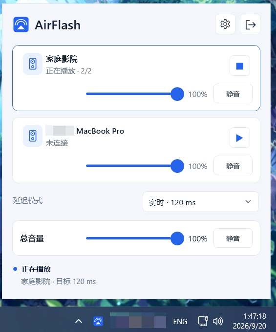

#  AirFlash

<p align="center">
  <a href="../README.md">English</a> ·
  <a href="README.zh-CN.md">简体中文</a>
</p>

<p align="center">
  
</p>

AirFlash 支持现有的双 HomePod 立体声组合和 Windows 低延迟播放。
通过原生 AirPlay 2 发送端，将 Windows 桌面声音发送到 HomePod，支持 HomePod OS 27。

AirFlash 是 TuneBlade（AirPlay 1）的 AirPlay 2 替代方案，旨在让 Windows
能够向运行较新版本 HomePod 软件的设备流送音频。

## 安装

从 [GitHub Releases](https://github.com/Ding-Kyoma/AirFlash/releases/latest) 下载并运行 `AirFlash-X.Y.Z.msi` 安装，或直接运行便携版 `AirFlash.exe`。

最低兼容目标为 **Windows x64，Windows 10 1809 / Build 17763（LTSC 2019）**，
同时覆盖 LTSC 2021、22H2 和 Windows 11。当前仍为兼容候选版本，需受影响用户实机验收。
启动失败时可使用 Windows 自带 PowerShell 5.1 收集报告；步骤与验收范围见
[Windows 兼容性与启动诊断](WINDOWS-COMPATIBILITY.md)。程序自包含，无需另装 .NET、Python 或 VC++ 运行库。

AirFlash 提供 Windows x64 可执行文件和可独立运行的 MSI 安装包。由于发布文件没有代码签名，Windows
可能显示 SmartScreen 警告。只有在确认下载文件来源可信时，才使用“更多信息”
和“仍要运行”。

音频采集建议在 **设置 > 音频采集** 中使用 **指定音频端点**。如果没有空闲可用的音频端点，
可以下载安装 [Virtual Audio Cable（VAC Lite）](https://software.muzychenko.net/freeware/vac471lite.zip)
等工具创建虚拟端点，并将需要投放的音频路由到该端点。

## 主要功能

- 通过 AirPlay 2 将 Windows 系统声音发送到 HomePod。
- 支持现有双 HomePod 立体声组合的同步播放。
- 新增实验性双接收端软件立体声、独立硬件音量、按设备 PCM/ALAC 与 UDP/TCP 设置，以及 5 ms 音频连续性过渡。
- 支持自动发现设备、PIN 配对和手动添加设备。
- 支持网卡过滤，可在设置中选择用于发现设备的网卡。
- 提供延迟模式、托盘运行、静音恢复、自动重连和连接诊断。
- 在设置中提供 10 段均衡器，支持音效预设和即时试听。
- 支持采集指定应用及其子进程，或播放与录音端点，包括虚拟音频设备。
- 支持静音超时后释放 AirPlay 会话，并在检测到声音后自动恢复。
- 提供便携式 Windows x64 程序，支持英文、简体中文和繁体中文界面。

## 功能计划

设置方法、schema v4、协议与测试范围见 [音频连续性与软件立体声](audio-stereo-v3.md)。
三星、Mac 和跨品牌组的实际出声、防爆音与声学同步仍待实机验收。

- [ ] 支持杜比 Atmos。

## 使用方法

1. 将电脑和两台 HomePod 连接到同一可互通的局域网。
2. 启动 AirFlash，等待接收端列表出现。
3. 选择完整的 `HomePod stereo · 2/2` 项目并点击播放。
4. 如果接收端要求 PIN，在“设置 > 接收器”中完成配对。
5. 如果默认设置不合适，在设置中选择采集端点和延迟模式。

在 **设置 > 接收器** 中分别设置每个接收器的编码、采样率、UDP/TCP 传输和时钟策略。
选项按接收器 `/info` 能力筛选，查询不会启动播放或触发配对。“自动”优先使用可用的
44.1 kHz，其次为 48 kHz；未播放时括号显示预计选择，播放时显示实际协商结果。
未应用的修改仍显示预计结果。离线或尚未检测的设备只提供自动选项，并保留已有显式值，
标记为待验证。原生立体声组使用成员共同支持的组合；软件立体声组统一控制成员采样率，
新组默认 44.1 kHz。

主面板的 **全局延迟模式** 修改共享默认值。当前连接、播放或待机目标使用独立延迟时，
该控件禁用，并提示前往 **设置 > 接收器** 调整；软件立体声组任一成员使用独立延迟时也一样。
停止播放后恢复可编辑，设置页始终可以修改全局默认延迟。

**设置 > 常规 > 重置并重启** 仅确认一次，然后清除全部设置和接收器配对。
程序会停止播放与发现、恢复本地静音状态、关闭开机启动，删除 `config.json` 和
`native-credentials`，再以默认设置重启。未保存的修改会丢弃，日志和引擎缓存保留。
配置升级为 schema v4：删除全局采样率；v1–v3 中原先继承全局采样率的设备改为自动，
已有的设备和软件组显式采样率保留。

设备发现在控制面板或“设置 > 接收器”页面可见时运行；活动软件立体声组也保持拓扑监听。
其他情况下两处都隐藏后暂停。
暂停时保留上次结果，不会中断播放。如果启用了全局或单个设备的自动连接，
程序启动后还会扫描 10 秒；之后打开设备列表即可恢复发现。

AirFlash 使用全新的应用数据目录 `%APPDATA%/AirFlash` 和
`%LOCALAPPDATA%/AirFlash`。它不会读取旧产品名称创建的配置、凭据或引擎
缓存；安装 AirFlash 后需要重新配置并重新配对。

在 **设置 > 关于 > 检查更新** 中手动查询正式版本并打开下载页；程序不会自动联网检查或安装更新。

实时模式目标延迟为 120 ms；目标值和本机传输统计不代表端到端声学延迟的实测值。

版本预留与发布方法见 [发布流程](RELEASING.md)。

矢量源图、资源生成与高 DPI 验收步骤见 [图标维护](ICONS.md)。

在 **设置 > 音频采集** 中，**指定音频端点**列出活动的播放与录音设备，并标注类型。
使用 Voicemeeter 时，选择对应 B1/B2/B3 总线的录音端点（例如 Voicemeeter Output），
再在 Voicemeeter 中为所需音频启用对应总线。播放设备使用回环采集，录音设备直接采集输入；
自动本地静音仅适用于播放设备，不会静音录音输入。

### 指定应用与虚拟音频路由

在 **设置 > 音频采集 > 指定应用** 中选择运行中的应用，可采集该应用及其子进程。
浏览器按整个进程树采集，不区分标签页。原生模式需要 Windows build 20348 或更高版本；
较旧系统仍可使用指定音频端点。选择按可执行文件路径保存，应用重启后会跟随唯一的匹配实例；
出现多个独立实例时需重新选择。应用不可用时等待，不会退回全局采集。

要让目标应用只在 HomePod 播放，同时让游戏和通知继续使用耳机，可安装
[VB-CABLE](https://vb-audio.com/Cable/) 等虚拟声卡，再通过 **打开 Windows 音量混合器**
仅将目标应用的输出设为 **CABLE Input**。采集来源可选择应用，或选择
**指定音频端点 > CABLE Output · 录音**。关闭“侦听此设备”及本地监听。
应用模式不会静音整个播放设备。停止 AirFlash 后，Windows 路由设置仍保留；
需要本地播放时可自行改回。虚拟声卡不保证采集受 DRM 保护的内容，采集、重采样和格式转换
也不保证逐位无损。

### 静音自动待机

在 **设置 > AirFlash 串流 > 待机** 中启用静音待机。默认关闭，静音时长默认 10 秒，
可设置为 5–300 秒，也可为接收器单独设置。达到时长后释放 AirPlay 会话，
本地继续检测声音；声音恢复后自动重新连接并播放当下音频。
重连期间的开头或短提示音可能丢失。会话释放后，HomePod 自行管理电源状态。

## 技术栈

- **C# / .NET 10 / WPF**：Windows 界面、托盘、设置和设备发现
- **Rust**：WASAPI 采集、AirPlay 2、HAP、PTP、RTP 和音频传输
- **Windows DNS-SD**：接收端发现
- **WASAPI loopback**：系统声音采集
- **PCM 和 ALAC**：通过加密 RTP 发送到 HomePod
- **uv、pytest、Ruff**：限时验证工具和 Python 检查

发布程序自包含，Rust 引擎静态链接 MSVC 运行库，不需要 Python、单独安装 .NET 运行时或单独安装 VC++ Redistributable。

## 开发与构建

开发需要 Windows 10/11 x64、.NET 10 SDK、Rust MSVC 工具链，以及 Visual
Studio C++/Windows SDK 组件。Python 3.12+ 和 `uv` 仅用于验证脚本。

```powershell
uv sync --locked
pwsh scripts/build-native.ps1 -Check
pwsh scripts/dotnet.ps1 restore AirFlash.sln --locked-mode
pwsh scripts/dotnet.ps1 run --project AirFlash.App/AirFlash.App.csproj
pwsh scripts/build.ps1
```

构建生成：

- `dist/AirFlash.exe`
- `dist/AirFlash-X.Y.Z.msi`

Rust 引擎会嵌入 WPF 可执行文件，运行时释放到
`%LOCALAPPDATA%/AirFlash/engine/<hash>` 内容寻址缓存。

## 测试

```powershell
pwsh scripts/dotnet.ps1 test AirFlash.sln
uv run pytest
uv run ruff check .
pwsh scripts/build-native.ps1 -Check
```

被忽略的 Rust 压力测试只使用 localhost UDP 接收端。真实 HomePod 测试严格
遵守仓库规定的低音量、最长五秒流程。

## 贡献

修改时请明确协议行为、配对边界和测量限制。欢迎提交 PR！

## 许可证

双重许可。AirFlash 可依据 GNU 通用公共许可证第 3 版或任何更高版本
（见 [LICENSE-GPLv3](../LICENSE-GPLv3)），或依据 AirFlash 商业授权
（见 [LICENSE-COMMERCIAL.md](../LICENSE-COMMERCIAL.md)；联系
https://github.com/Ding-Kyoma/AirFlash/issues）使用。协议实现和依赖声明见
[native/airflash-engine/README.md](../native/airflash-engine/README.md) 与
[desktop/THIRD-PARTY-NOTICES.md](../desktop/THIRD-PARTY-NOTICES.md)。
